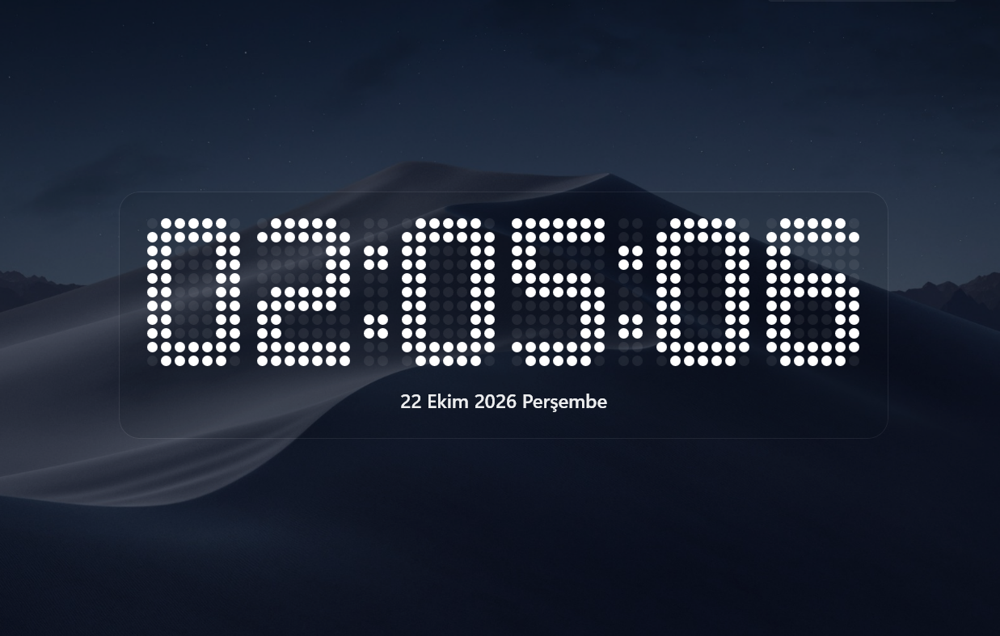
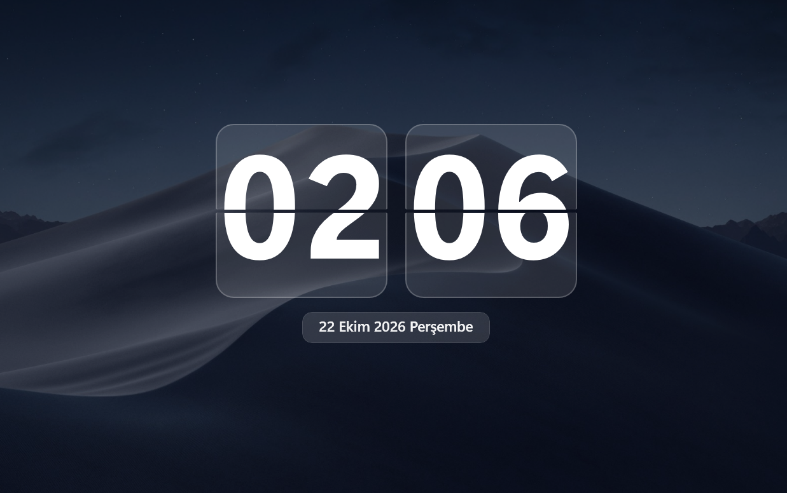
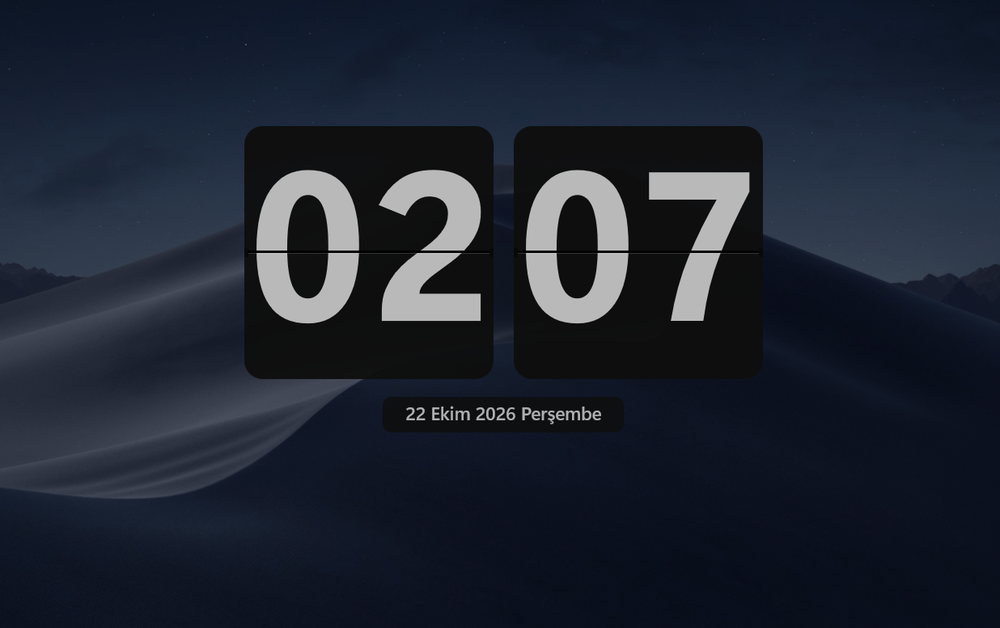
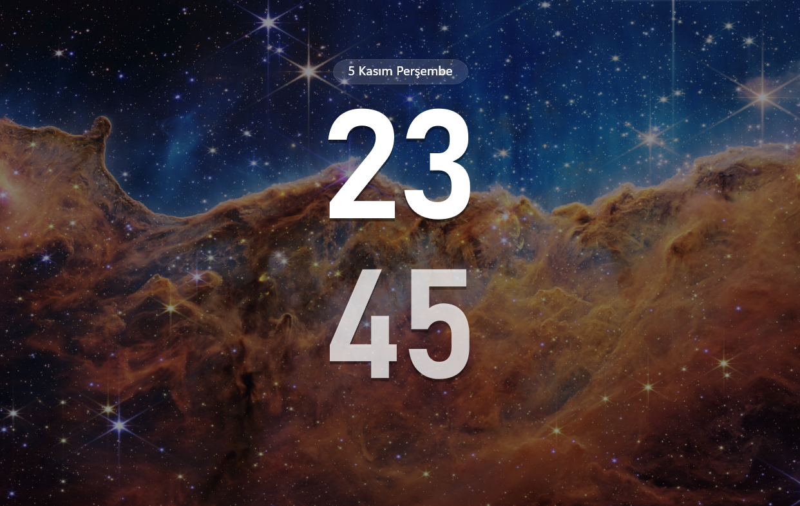
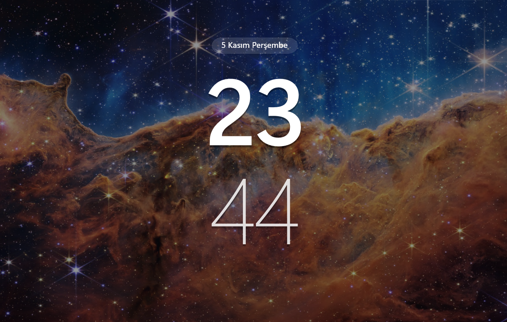
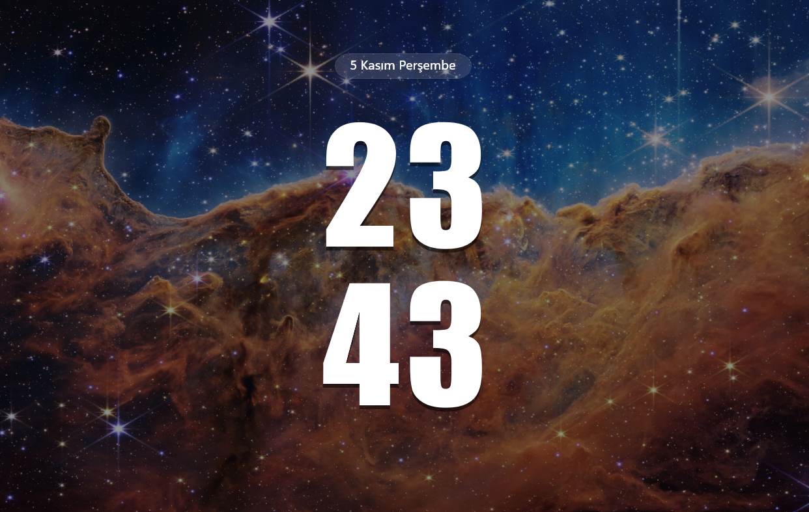
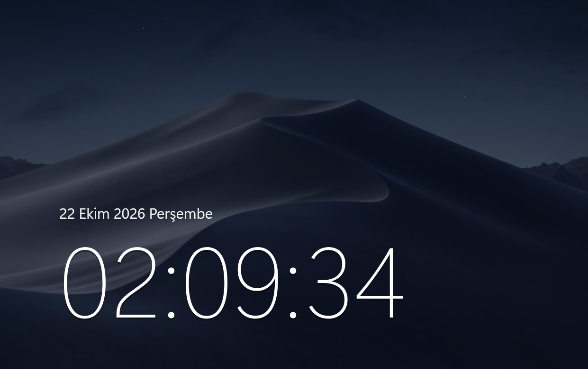
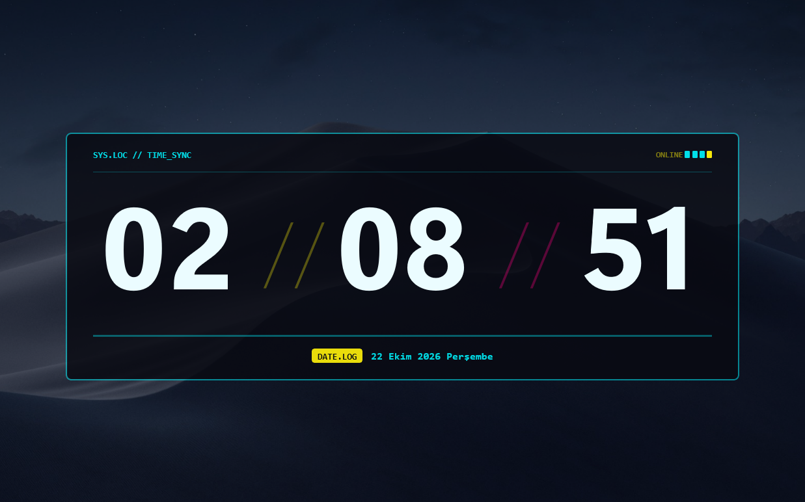

# Lock Screen Clock Styler

**Elevate your Windows 11 lock screen clock with modern bespoke aesthetics, frosted acrylic cards, live power telemetry, and clean clutter-free layout controls.**

---

## 🌟 Overview

**Lock Screen Clock Styler** is a high-performance native [Windhawk](https://windhawk.net/) customization mod for the Windows 11 lock screen application (`LockApp.exe`).

It replaces the default Windows lock screen clock and MSN news/widget clutter with 9 distinct clock aesthetics — ranging from Apple macOS Sonoma typography and physical split-flap mechanical flip cards to authentic 7x11 retro LED dot matrices, 2-row vertical stack layouts, and tactical Cyberpunk HUD terminals. Built with **C++/WinRT**, it discovers the lock screen visual tree from the lock screen's own UI thread and injects custom XAML directly into the compositor with no XAML DispatcherTimer and full thread safety.

> [!NOTE]
> **Safety First:** This mod exclusively modifies the user-space lock app (`LockApp.exe`). It does **not** inject into or hook `LogonUI.exe` or `winlogon.exe` (Secure Desktop), ensuring system stability and zero security risks.

---

## 🎨 Themes & Clock Styles

| Style | Key | Aesthetic Description |
| :--- | :---: | :--- |
| 👾 **Retro Pixel / LED Matrix** | pixel | Authentic 7x11 double-pixel LED dot matrix display with subtle ambient dot glow and frosted acrylic contrast backplate. |
| ⏳ **Modern Flip Clock** | lip | Split acrylic frosted glass cards with bold proportions, Fliqlo-inspired horizontal scissors-cut split seam, and smooth rounded corners. |
| 📜 **Classic Flip Clock** | intage | Solari-inspired mechanical train terminal clock with matte charcoal flap cards, aged ivory typography, split seam, and axle hinge clips. |
| 📱 **Vertical Pixel / Nothing OS (Bahnschrift)** | erticalBahnschrift | Nothing OS and DIN-standard geometric typography in a 2-row vertical stack, featuring SemiBold Bahnschrift numerals with subtle minute contrast and compact line spacing. |
| ✨ **Vertical Modern / Dual Weight (Segoe UI)** | erticalSegoe | Striking dual-weight vertical presentation pairing bold hour digits with extra-light Segoe UI Variable Display minutes for high typographic hierarchy and ultra-clean modern framing. |
| 📰 **Vertical Poster / Heavy Impact (Impact)** | erticalImpact | Bold condensed Swiss poster aesthetic utilizing ultra-heavy Impact typography, tight vertical spacing, and high-impact visual presence reminiscent of brutalist editorial layouts. |
| 🪐 **Minimalist Sonoma** | macos | Apple lock screen aesthetic with date positioned above the time, ultra-slender display numerals, dual-layer atmospheric shadows, and elegant left alignment. |
| ⚡ **Cyberpunk Sci-Fi HUD** | cyberpunk | Tactical Netrunner HUD terminal with obsidian chassis, acid yellow & hot magenta corner brackets, top telemetry diagnostic bar, and pulsating laser dividers (//). |
| 🌌 **Minimalist Aura** | ura | Clean frameless floating typography with ambient soft drop-shadow depth and an elegant frosted date capsule. |
| 🪟 **Default Clock Only** | defaultOnly | Keeps the stock Windows 11 lock screen clock. Widget suppression remains available through its own toggle. |

---

## 📸 Screenshots

  
  
   
  
  
   
  
  
   
  
  

> Captured on Windows 11 (26H2).

---

## ✨ Core Highlights & Features

- 🔋 **Live Smart Battery Telemetry Capsule:**
  - Displays real-time laptop battery percentage with charging indicators (`⚡` charging, `🔋` battery level).
  - Automatically hidden on desktop PCs without cluttering the screen.
- 🕒 **12-Hour & 24-Hour Time Engine:**
  - Full support for standard 24-hour time or 12-hour AM/PM format.
  - Bespoke, theme-tailored AM/PM status badges (vintage flip stamp, tactical HUD status pill, minimal text).
- ⏱️ **Real-Time Seconds Toggle:**
  - Opt-in live seconds display, supported by every style except the mechanical flip clocks and 2-row vertical stack styles.
  - The settings toggle is the single source of truth, so switching styles never leaves a stale per-theme preference behind.
- 🛡️ **Single-Instance Guard & Reconnect Engine:**
  - Periodically rescans the lock screen visual tree and re-injects the clock safely when Windows rebuilds it.
  - Removes the previous clock before attaching the new one, preventing duplicate clock glitches.
- 🧵 **Thread-Safe UI Dispatch:**
  - A `WH_GETMESSAGE` hook on the lock screen UI thread drives updates; every XAML read and write stays on that thread.
  - Settings reloads and unload cleanup are dispatched synchronously with a `WH_CALLWNDPROC` message, so no mod code can be left running when the DLL unloads.
- 🧩 **No XAML Diagnostics TAP:**
  - Finds the lock screen tree through `Window::Current().Content()` and `VisualTreeHelper` instead of registering a XAML Diagnostics TAP.
  - Can run alongside other XAML-based Windhawk mods such as Windows 11 Start Menu Styler.
- 🧹 **Stock Widget & Clutter Cleaner:**
  - Instantly hide MSN weather, sports scores, finance stocks, and news cards with a single toggle.
- 📐 **Smart Theme-Aware Alignment:**
  - Automatic (`auto`) alignment aligns Minimalist Sonoma to the bottom-left corner while keeping other clock styles centered, with full manual override (`center`, `bottomLeft`, `left`, `right`).

---

## 🆕 What's New in v0.6.0

- 📱 **3 Brand-New Vertical Stack Clock Styles:** Added **Vertical Pixel / Nothing OS (Bahnschrift)**, **Vertical Modern / Dual Weight (Segoe UI Variable)**, and **Vertical Poster / Heavy Impact (Impact)** featuring custom line overlapping, high-contrast weight pairing, and localized natural long-date capsules.
- 💤 **Laptop Sleep/Wake Black Screen Fix (#6978):** Fixed lock screen background turning black after laptop sleep/wake (Modern Standby & S3/S4) via native console display and power state callbacks (`RegisterSuspendResumeNotification` & `PowerSettingRegisterNotification`) with zero UI thread contention during quiesce.
- ⚡ **Startup Settings Synchronization:** Closed startup race conditions to guarantee clock style, alignment, and formatting preferences apply reliably upon initial shell launch.

---

## ⚙️ Configuration Reference

All settings can be customized instantly from the **Settings** tab in the Windhawk user interface:

| Option | Setting Key | Allowed Values / Range | Default | Purpose |
| :--- | :--- | :--- | :---: | :--- |
| **Clock Style** | `clockStyle` | `pixel`, `flip`, `vintage`, `verticalBahnschrift`, `verticalSegoe`, `verticalImpact`, `macos`, `cyberpunk`, `aura`, `defaultOnly` | `pixel` | Selects visual clock theme. |
| **Time Format** | `timeFormat` | `24h`, `12h` | `24h` | Toggle between 24-hour and 12-hour AM/PM display. |
| **Clock Alignment** | `clockAlignment` | `auto`, `center`, `bottomLeft`, `left`, `right` | `auto` | Screen placement (`auto` uses theme default). |
| **Show Seconds** | `showSeconds` | `true`, `false` | `true` | Live seconds (all styles except `flip`, `vintage`, and vertical stack themes). |
| **Battery Status** | `showBatteryStatus`| `true`, `false` | `false` | Laptop battery percentage and charging capsule. |
| **Show Date Capsule** | `showDateCapsule` | `true`, `false` | `true` | Localized date and weekday display capsule. |
| **Glass Opacity** | `glassOpacity` | `0` to `255` | `45` | Translucency of the Modern Flip cards. |
| **Digit Font Size** | `clockFontSize` | `20` to `300` | `140` | Base font size for clock digits. |
| **Vertical Offset** | `verticalOffset` | `-200` to `+400` px | `0` | Vertical screen shift adjustment. |
| **Hide Default Widgets**| `hideDefaultWidgets`| `true`, `false` | `false` | Hides MSN weather, news, and stock widgets. |
| **Hide Default Clock** | `hideDefaultClock` | `true`, `false` | `true` | Replaces the stock Windows 11 lock screen clock. |

---

## 🚀 Installation & Usage

### Method 1: Official Windhawk Repository (Recommended)

1. Download and install **[Windhawk](https://windhawk.net/)** (if not already installed).
2. Open the official mod page: **[Lock Screen Clock Styler on Windhawk](https://windhawk.net/mods/lock-screen-clock-styler)** (or search for **Lock Screen Clock Styler** inside the Windhawk **Explore** tab).
3. Click **Details** &rarr; **Install**.
4. Press <kbd>Win</kbd> + <kbd>L</kbd> to lock your screen and enjoy your new lock screen clock!

### Method 2: Manual Installation (for Developers)

1. Open the Windhawk manager, navigate to the **Advanced** tab, and click **Create Mod**.
2. Copy the entire source code from [`lock-screen-clock-styler.wh.cpp`](./lock-screen-clock-styler.wh.cpp) and paste it into the Windhawk editor.
3. Click **Compile** (`Ctrl + B`).
4. Once compiled, save and enable the mod.

> [!TIP]
> You can tweak themes, font sizes, live seconds, and alignments on the fly in the **Settings** tab inside Windhawk without needing to recompile.

---

## 🔒 Security & Architecture

- **Target Process:** Injects strictly into `LockApp.exe`, installs a message hook on its `Windows.UI.Core.CoreWindow` thread, and walks the visual tree from that UI thread. No XAML Diagnostics TAP is registered.
- **No Secure Desktop Access:** Never hooks into or touches `LogonUI.exe` or `winlogon.exe`. Credential entry and authentication remain 100% untouched and secure.
- **Resource Efficient:** Uses dirty-checking caches and message-driven updates (500 ms with seconds, 1000 ms otherwise) instead of a polling timer. Default-clock mode performs no clock rendering at all.
- **Compatibility:** Tested and validated on Windows 11 versions **24H2**, **25H2**, and **26H2** (Build 26200+). The TAP-free design allows coexistence with other XAML-based Windhawk mods.

---

## 🤝 Contributing & Feedback

Feedback, bug reports, and theme suggestions are warmly welcomed! If you have an idea for a new clock style, encounter an issue, or would like to contribute code:
- Open an issue or submit a pull request on the [GitHub repository](https://github.com/ali0zdas/windhawk-mod-lock-screen-clock-styler).
- Share your setup or suggest new aesthetic styles for upcoming releases!

---

## 📄 License

This project is licensed under the [MIT License](LICENSE) &copy; 2026 [ali0zdas](https://github.com/ali0zdas).
